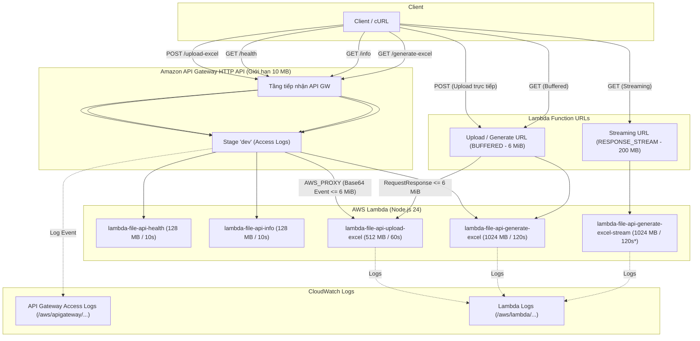

# AWS Lambda File Processing API

> **Mini-project tìm hiểu giới hạn kích thước, cách upload và xuất file Excel trên AWS Lambda (Node.js 24 & TypeScript)**

---

## 1. Giới thiệu

Khi xử lý file nhị phân (như Excel `.xlsx`) trực tiếp trên AWS Lambda mà không dùng S3 hay database trung gian, mình sẽ gặp một số giới hạn về kích thước request/response, việc dữ liệu bị phình lên khi mã hóa Base64, và timeout.

Đây là một **mini-project nhỏ** dùng để thử nghiệm và đo thực tế các giới hạn đó trên AWS Serverless.

### Những điểm chính được thử nghiệm
1. **Giới hạn khi upload file:** So sánh thực tế giữa API Gateway HTTP API (mức chặn 10 MB) và giới hạn gọi đồng bộ của AWS Lambda (6 MiB = `6,291,456 bytes`).
2. **Chi phí Base64:** Khi gửi file nhị phân qua API Gateway v2 hoặc Function URL, nội dung bị chuyển sang Base64 (+33.3% dung lượng), kéo kích thước file thô tối đa có thể upload xuống còn khoảng ~4.50 MiB (`~4.72 MB`).
3. **Cách trả file về (`BUFFERED` vs `RESPONSE_STREAM`):** So sánh giữa trả một cục đồng bộ (bị chặn ở 6 MiB) và truyền từng phần qua Function URL `RESPONSE_STREAM` (tài liệu AWS ghi tối đa 200 MB).
4. **Kiểm tra nguồn gốc lỗi `HTTP 413`:** Kết hợp API Gateway Access Logs, cURL và CloudWatch Logs của Lambda để biết request bị chặn trước khi vào Stage, lúc gọi Lambda, hay trong code handler.

### Công nghệ sử dụng
* **Runtime:** Node.js 24 (`nodejs24.x`), viết bằng TypeScript.
* **Cổng API:** AWS API Gateway HTTP API (Payload Format 2.0) và AWS Lambda Function URLs (`BUFFERED` & `RESPONSE_STREAM`).
* **Xử lý Excel:** Thư viện `exceljs`.
* **Log:** Amazon CloudWatch Logs.

---

## 2. Kiến trúc tổng thể



### Các hàm Lambda trong bài thực hành
* **`health` & `info`:** Kiểm tra trạng thái chạy của Lambda và trả về danh sách các giới hạn AWS để tra cứu nhanh.
* **`upload-excel`:** Giải mã Base64, tách file từ `multipart/form-data` (nếu có), chặn file > 5 MiB (`MAX_PARSE_BYTES`), kiểm tra 4 byte đầu `PK\x03\x04` của file `.xlsx`, rồi đọc số dòng/cột và 5 dòng mẫu.
* **`generate-excel`:** Tạo file `.xlsx` trong RAM, chuyển sang Base64 và trả về 1 cục đồng bộ.
* **`generate-excel-stream`:** Tạo file `.xlsx` hoặc bơm dữ liệu giả lập (`?mode=synthetic`) theo từng chunk `64 KiB` qua `awslambda.streamifyResponse`.

---

## 3. Cấu trúc thư mục

```
lambda-file-processing-api/
├── README.md                      ← Giới thiệu và cấu trúc mini-project
├── package.json                   ← Dependencies (exceljs) và npm scripts
├── tsconfig.json                  ← Cấu hình biên dịch TypeScript
├── src/                           ← Mã nguồn TypeScript
│   ├── handlers/                  ← 5 Lambda handlers
│   │   ├── health.ts
│   │   ├── info.ts
│   │   ├── uploadExcel.ts
│   │   ├── generateExcel.ts
│   │   └── generateExcelStream.ts
│   └── utils/                     ← Tiện ích sinh/đọc Excel & tách multipart
│       ├── excelGenerator.ts
│       ├── excelParser.ts
│       └── multipartParser.ts
├── infra/                         ← Các script Bash + AWS CLI để dựng và test
│   ├── 00-variables.sh            ← Biến dùng chung (Region, Account, tên hàm)
│   ├── 01-iam.sh                  ← Tạo Execution Role (chỉ ghi CloudWatch Logs)
│   ├── 02-lambda.sh               ← Deploy 5 hàm Lambda
│   ├── 03-apigateway.sh           ← Tạo HTTP API, routes, Stage 'dev' & Access Logs
│   ├── 04-function-url.sh         ← Tạo Function URLs (BUFFERED & RESPONSE_STREAM)
│   ├── 05-test.sh                 ← Chạy 21 test kiểm tra chức năng và ranh giới
│   └── 06-benchmark.sh            ← Đo thời gian upload, memory scaling, timeout & streaming
├── scripts/                       ← Script build zip và tạo file test
│   ├── package.sh                 ← Build TypeScript và đóng gói .zip vào zips/
│   ├── generate-test-files.mjs    ← Tạo file Excel mẫu theo dung lượng
│   └── test-local.mjs             ← Chạy test logic ở local không cần AWS
├── test-files/                    ← File Excel mẫu để test
│   ├── generated/
│   └── datasets/
└── docs/
    └── EXPERIMENT_REPORT.md       ← Ghi chép kết quả thực nghiệm (Giai đoạn 01–06)
```

---

## 4. Kết quả ghi nhận

Mini-project đã chạy qua đủ 6 bước từ dựng hạ tầng (`01`–`04`), kiểm thử chức năng & ranh giới (`05-test.sh`: 21/21 PASS) đến đo hiệu năng (`06-benchmark.sh`: so sánh kênh upload, memory scaling 128–1,024 MB, timeout 5s và streaming tới mốc 205 MiB).

Chi tiết số liệu đo được, log đối chiếu và các ghi chú kỹ thuật được tổng hợp trong:
* 📄 **[docs/EXPERIMENT_REPORT.md](docs/EXPERIMENT_REPORT.md)**
