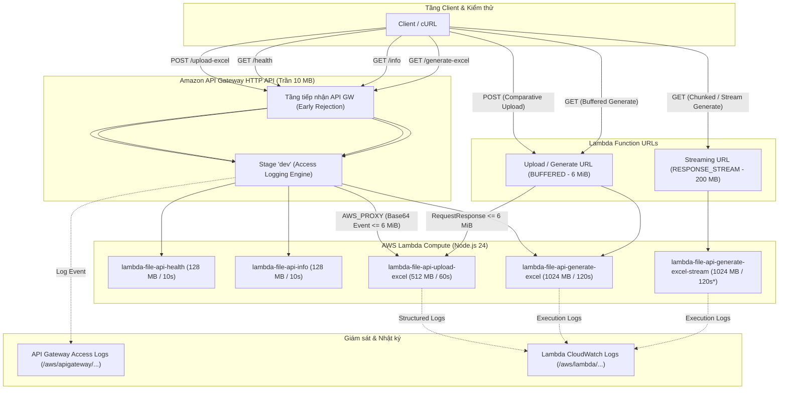

# AWS Lambda File Processing API

> **Khảo sát chuyên sâu giới hạn kiến trúc, cơ chế tải và xử lý file Excel trên AWS Serverless (Node.js 24 & TypeScript)**

---

## 1. Giới thiệu dự án

Trong kiến trúc điện toán không máy chủ (Serverless), việc xử lý các tệp tin nhị phân có dung lượng vừa và lớn (như bảng tính Excel `.xlsx`) thường gặp phải các rào cản kỹ thuật nghiêm ngặt về kích thước tải trọng (payload quota), hiện tượng phình to dữ liệu do mã hóa (Base64 inflation), độ trễ truyền dữ liệu (latency), và thời gian chờ tối đa (timeout). 

**Lambda File Processing API** là dự án nghiên cứu và thực nghiệm kiến trúc nhằm khảo sát, kiểm chứng và phân tích một cách có hệ thống các giới hạn thực tế của AWS Serverless khi xử lý tệp bảng tính Excel, hoàn toàn **không phụ thuộc vào dịch vụ lưu trữ trung gian S3, Database hay Frontend**.

### Vấn đề kỹ thuật được khảo sát
1. **Ranh giới kích thước tải lên (Upload Boundary):** Sự khác biệt giữa giới hạn lý thuyết và giới hạn thực tế khi truyền file nhị phân qua API Gateway HTTP API (trần danh định 10 MB) so với trần gọi đồng bộ của AWS Lambda (trần cứng 6 MiB = `6,291,456 bytes`).
2. **Chi phí Base64 Inflation:** Cơ chế tự động mã hóa Base64 các nội dung nhị phân trong sự kiện JSON của API Gateway v2 khiến dung lượng thực tế tăng thêm ~33.3%, kéo trần tải file thực xuống ngưỡng ~4.50 MiB (`~4.72 MB`).
3. **Cơ chế phản hồi tải về (Download / Response Delivery):** So sánh giữa cơ chế gom toàn bộ vào bộ nhớ đệm (**BUFFERED**) và cơ chế truyền dòng từng phần (**RESPONSE_STREAM**) để vượt qua giới hạn phản hồi 6 MiB, hỗ trợ payload theo tài liệu AWS lên tới 200 MB.
4. **Khả năng quan sát hạ tầng (Deep Observability):** Bóc tách nguồn gốc từ chối của mã lỗi `HTTP 413 Payload Too Large` để phân biệt yêu cầu bị chặn trước giai đoạn Stage Integration của API Gateway, tại bước Lambda Synchronous Invocation hay tầng Logic nghiệp vụ (Application Memory Guard).

### Công nghệ và dịch vụ AWS chính
* **Môi trường thực thi:** Node.js 24 (`nodejs24.x`) chạy trên AWS Lambda, lập trình bằng TypeScript.
* **Cổng giao tiếp API:** AWS API Gateway HTTP API (Payload Format Version 2.0).
* **Điểm cuối trực tiếp:** AWS Lambda Function URLs (chế độ `BUFFERED` và `RESPONSE_STREAM`).
* **Thư viện xử lý Excel:** `exceljs` để khởi tạo, stream và phân tích bảng tính OpenXML SpreadsheetML.
* **Giám sát & Nhật ký:** Amazon CloudWatch Logs (bao gồm Lambda Execution Logs và API Gateway Stage Access Logs).

---

## 2. Kiến trúc tổng thể

Hệ thống được thiết kế theo hướng phân tách trách nhiệm (Single Responsibility Principle) với các luồng xử lý độc lập để đối chiếu hành vi của từng lớp hạ tầng.



### Vai trò của từng thành phần
1. **API Gateway HTTP API:** Đóng vai trò là cổng phân phối API chính, cấu hình định tuyến (routes), quản lý CORS, và kiểm soát trần tải trọng ở tầng biên (10 MB). Cung cấp cơ chế Access Logging để ghi nhận chi tiết thời gian xử lý và trạng thái integration.
2. **Lambda Functions chuyên biệt:**
   - `health` & `info`: Phản hồi trạng thái hoạt động và công bố danh mục giới hạn phần cứng/dịch vụ của AWS.
   - `upload-excel`: Giải mã Base64, bóc tách dữ liệu (hỗ trợ cả raw binary và multipart/form-data), kiểm tra bộ nhớ đệm (Memory Guard 5 MiB), thẩm định chữ ký ZIP/PK của OpenXML, và phân tích cấu trúc bảng tính.
   - `generate-excel`: Khởi tạo bảng tính Excel trong RAM và đóng gói Base64 trả về dưới dạng nhị phân đồng bộ.
   - `generate-excel-stream`: Khởi tạo bảng tính hoặc dòng dữ liệu giả lập (synthetic chunks) và truyền trực tiếp về client thông qua `awslambda.streamifyResponse`.
3. **Lambda Function URLs:** Cung cấp điểm truy cập HTTPS trực tiếp tới hàm Lambda nhằm loại bỏ các can thiệp hoặc giới hạn timeout 29 giây của API Gateway, cho phép thử nghiệm truyền dữ liệu dòng lớn (giới hạn công bố của AWS: 200 MB).
4. **CloudWatch Logs:** Lưu trữ dấu vết thực thi có cấu trúc (Structured JSON) chứa `requestId`, `apiGwRequestId`, `awsRequestId`, kích thước bytes thực tế và trạng thái của từng lớp.

---

## 3. Phạm vi chức năng

Dự án hiện đã triển khai đầy đủ các nhóm chức năng phục vụ kiểm thử và đo lường:

* **Health Check & Metadata Quotas (`GET /health`, `GET /info`):** Kiểm tra trạng thái runtime Node.js v24 và truy xuất thông số giới hạn dịch vụ do AWS công bố.
* **Tải lên & Phân tích Excel (`POST /upload-excel`):**
  - Hỗ trợ tải file nhị phân trực tiếp (`application/octet-stream`) hoặc qua biểu mẫu đa phần (`multipart/form-data`).
  - Phân tích số dòng, số cột, sheet name và trích xuất dữ liệu xem trước (preview rows).
  - Kiểm định chữ ký file ZIP/PK, trả về mã `HTTP 422 Unprocessable Entity` đối với file hỏng hoặc giả mạo.
  - Bộ bảo vệ bộ nhớ đệm (`MAX_PARSE_BYTES = 5 MiB = 5,242,880 bytes`), trả về `HTTP 413` nếu file vượt ngưỡng an toàn của heap.
* **Tạo file Excel đồng bộ (`GET /generate-excel`):** Tạo file Excel mẫu chuẩn dung lượng nhỏ (1,000 dòng) và dung lượng lớn (50,000 dòng, `~2.466 MiB` / `~2.585 MB`) truyền qua API Gateway và Function URL Buffered.
* **Truyền phản hồi dạng dòng (Response Streaming via Function URL):**
  - Chế độ tạo bảng tính Excel 50,000 dòng truyền trực tiếp qua HTTP chunked transfer.
  - Chế độ dòng dữ liệu giả lập (Synthetic Chunked Streaming) với các gói dung lượng từ `1–50 MiB` (Giai đoạn 05) và `10–205 MiB` (Giai đoạn 06), kích thước chunk `64 KiB`.
* **Khung chẩn đoán Observability 3 tầng:**
  - Tầng A: API Gateway Access Logs ghi nhận chi tiết `integrationStatus`, `integrationLatency`, `integrationErrorMessage`.
  - Tầng B: Lambda Handler Entry Logs đối chiếu `apigw-requestid` với `awsRequestId`.
  - Tầng C: Function URL Upload đối chiếu ranh giới 6 MiB độc lập.

---

## 4. Cấu trúc dự án

```
lambda-file-processing-api/
├── README.md                      ← Tài liệu tổng quan kiến trúc và hướng dẫn dự án
├── PLAN.md                        ← Kế hoạch kỹ thuật chi tiết và tiến độ triển khai
├── package.json                   ← Khai báo dependencies (exceljs) và build scripts
├── tsconfig.json                  ← Cấu hình biên dịch TypeScript cho Node.js 24
├── src/                           ← Mã nguồn ứng dụng (TypeScript)
│   ├── handlers/                  ← Các hàm xử lý Lambda
│   │   ├── health.ts              ← Handler kiểm tra trạng thái dịch vụ
│   │   ├── info.ts                ← Handler trả về tài liệu giới hạn hệ thống
│   │   ├── uploadExcel.ts         ← Handler nhận file, parse và kiểm tra giới hạn
│   │   ├── generateExcel.ts       ← Handler tạo file Excel đồng bộ (BUFFERED)
│   │   └── generateExcelStream.ts ← Handler tạo file/synthetic stream (RESPONSE_STREAM)
│   └── utils/                     ← Thư viện tiện ích
│       ├── excelGenerator.ts      ← Tiện ích sinh dữ liệu bảng tính bằng ExcelJS
│       ├── excelParser.ts         ← Tiện ích đọc và trích xuất dữ liệu bảng tính
│       └── multipartParser.ts     ← Tiện ích bóc tách file từ multipart form-data
├── infra/                         ← Bộ kịch bản tự động hóa hạ tầng (Bash + AWS CLI)
│   ├── 00-variables.sh            ← Biến môi trường dùng chung (Region, Account, Function names)
│   ├── 01-iam.sh                  ← Khởi tạo Execution Role và chính sách quyền tối thiểu
│   ├── 02-lambda.sh               ← Khởi tạo và cập nhật 5 Lambda Functions
│   ├── 03-apigateway.sh           ← Cấu hình HTTP API, Routes, Stage 'dev' và Access Logging
│   ├── 04-function-url.sh         ← Cấu hình Function URLs (BUFFERED & RESPONSE_STREAM)
│   ├── 05-test.sh                 ← Bộ kịch bản kiểm thử tích hợp & kiểm tra ranh giới (21 test cases)
│   └── 06-benchmark.sh            ← Bộ kịch bản đo lường hiệu năng, memory scaling, timeout & streaming
├── scripts/                       ← Scripts hỗ trợ đóng gói và sinh dữ liệu mẫu
│   ├── package.sh                 ← Biên dịch TypeScript và đóng gói các tệp .zip trong zips/
│   ├── generate-test-files.mjs    ← Sinh file Excel kiểm thử theo dung lượng mục tiêu chính xác (±5%)
│   └── test-local.mjs             ← Bộ kiểm thử logic nội bộ không cần AWS
├── test-files/                    ← Thư mục lưu trữ tệp tin kiểm thử
│   ├── generated/                 ← Tệp Excel sinh tự động (1MB, 3MB, 5MB, 12MB, file hỏng)
│   └── datasets/                  ← Tệp dữ liệu thực tế (Online Retail.xlsx ~ 23 MB)
└── docs/                          ← Tài liệu chuyên sâu
    └── EXPERIMENT_REPORT.md       ← Báo cáo thực nghiệm chi tiết toàn diện từ Giai đoạn 01 đến 06
```

---

## 5. Kết quả thực nghiệm và Tài liệu liên quan

Dự án đã hoàn thành toàn bộ 6 giai đoạn triển khai và đo lường:
1. **Hạ tầng tự động hóa:** Hoàn tất từ `01-iam.sh` đến `04-function-url.sh`.
2. **Kiểm thử tích hợp & Ranh giới:** Thực thi trọn vẹn `05-test.sh` với kết quả **21/21 kịch bản kiểm thử đạt chuẩn (PASS)**.
3. **Đo lường hiệu năng chuyên sâu:** Thực thi trọn vẹn `06-benchmark.sh` với 4 bài test (Upload 100k rows, Memory scaling 128 MB–1,024 MB kèm CloudWatch REPORT, Timeout 5s xác nhận qua API Gateway Access Log, và Response Streaming từ 10 MiB tới mốc 205 MiB).

Để nắm bắt toàn bộ chi tiết quá trình triển khai, số liệu đo lường thực tế, cơ chế bóc tách nguyên nhân lỗi HTTP 413, phân tích vCPU scaling, tiêu thụ tài nguyên GB-seconds và quan sát cắt luồng tại ngưỡng ~200 MiB, vui lòng tham khảo các tài liệu sau:

* 📄 **[Báo cáo Thực nghiệm Toàn diện (docs/EXPERIMENT_REPORT.md)](docs/EXPERIMENT_REPORT.md):** Tài liệu phân tích chuyên sâu từng giai đoạn từ `01` đến `06`, bao gồm bảng ma trận 21 test case, số liệu benchmark RAM/CPU, đối chiếu độ trễ và kết quả khảo sát ngưỡng phản hồi ~200 MiB.
* 📋 **[Kế hoạch & Đặc tả Kỹ thuật (PLAN.md)](PLAN.md):** Kế hoạch chi tiết, nhật ký kỹ thuật của dự án, và khung phương pháp luận quan sát 3 tầng.
